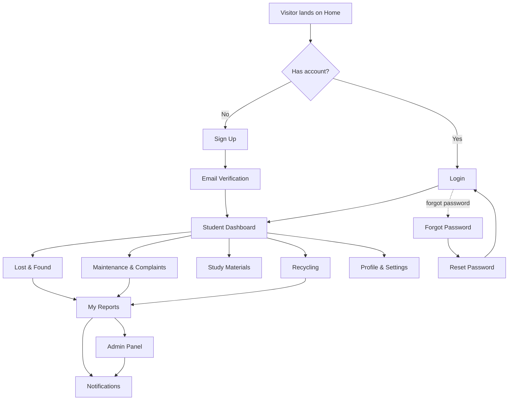

# NED Campus Connect — Product Requirements Document (PRD)

## 1. Product Overview

NED Campus Connect is the student-facing web platform for NED University of Engineering & Technology, Karachi, presented under the tagline **"Together for a Better Campus"**. It gives students one place to report lost items, raise maintenance complaints, find affordable study materials, and locate recycling points, while giving administration a single console to review and resolve every report.

The product solves campus-wide fragmentation: problems today are reported verbally or through scattered WhatsApp groups, with no tracking. NED Campus Connect centralises reporting, makes status visible, and gives admins a triage queue.

**Target value:** a faster, transparent, self-service campus operations loop for ~15,000 students, with a measurable reduction in unresolved complaints.

## 2. Core Features

### 2.1 User Roles

| Role | Registration Method | Core Permissions |
|------|---------------------|------------------|
| Student | University email + email verification | Submit lost & found posts, file maintenance complaints, list study materials, submit waste reports, view own reports and notifications, manage profile |
| Admin | Pre-provisioned staff account | View every report across all categories, filter by category/status, change report status, review evidence and resolve items |

### 2.2 Feature Module

1. **Home page (`/`)** — public marketing shell: navigation, hero, primary CTA, supporting statistics, four feature cards.
2. **Sign Up (`/signup`)** — account creation form with pale-green branding panel.
3. **Login (`/login`)** — credential form with pale-green branding panel.
4. **Email Verification (`/verify-email`)** — centred six-box code entry with resend and change-email actions.
5. **Forgot Password (`/forgot-password`)** — centred single-field recovery form.
6. **Reset Password (`/reset-password`)** — centred new-password + confirm form with strength hint.
7. **Error pages (`/404`, `/403`, `/500`)** — centred illustration, error code, heading, description, actions.
8. **Student Dashboard (`/dashboard`)** — greeting, stat cards, recent activity, quick module shortcuts.
9. **Lost & Found (`/lost-found`)** — search, category filters, item card grid, post-item dialog.
10. **Maintenance & Complaints (`/maintenance`)** — complaint form, issue/location selectors, description, image upload UI, common-issues panel.
11. **Study Materials (`/study-materials`)** — search, category filters, material cards with price and listing action.
12. **Recycling (`/recycling`)** — recycling location list, map-style placeholder panel with markers, waste-report form, bin-type selection.
13. **My Reports (`/my-reports`)** — tabular report list with category, title, status badge, date, detail action.
14. **Notifications (`/notifications`)** — notification feed with icons, descriptions, timestamps, read/unread styling.
15. **Profile & Settings (`/profile`)** — profile form, account settings, notification preferences, privacy settings.
16. **Admin Panel (`/admin`)** — summary cards, report-management table, category and status filters, review actions.

### 2.3 Page Details

| Page Name | Module Name | Feature description |
|-----------|-------------|---------------------|
| Home | Top navigation | Logo, links (Home, Features, About), Login and Sign Up actions; collapses to a mobile drawer |
| Home | Hero | Headline "A Smarter Campus. A Stronger Community", supporting paragraph, primary CTA to Sign Up and secondary CTA to Login, campus illustration |
| Home | Stats strip | Four numeric counters (reports resolved, materials listed, recycling points, active students) |
| Home | Feature cards | Four cards — Lost & Found, Maintenance, Study Materials, Recycling — each with icon, title, description and link into the module |
| Home | Footer | Brand, tagline, quick links |
| Sign Up | Branding panel | Pale-green right panel with NED logo, "NED University of Engineering & Technology", supporting copy, architectural illustration |
| Sign Up | Form | Full name, university email, student ID, password with visibility toggle, confirm password, terms checkbox, submit; inline validation errors |
| Login | Branding panel | Same pale-green panel treatment as Sign Up |
| Login | Form | Email, password with visibility toggle, remember-me, forgot-password link, submit, "create account" link |
| Email Verification | Code entry | Envelope icon, six single-character boxes with auto-advance, Verify button, resend-code text with countdown, change-email link |
| Forgot Password | Form | Envelope icon, email field, Send Reset Link button, back-to-login link, success confirmation state |
| Reset Password | Form | Lock icon, new password, confirm password, requirement checklist, Reset Password button, back-to-login link |
| Error pages | Centred state | Large error code, heading, description, "Back to Home" and "Go Back" actions |
| Dashboard | Greeting header | "Welcome back, Ahmed" with date and search |
| Dashboard | Stat cards | Open reports, resolved reports, notifications, recycling points |
| Dashboard | Recent activity | List of latest reports with status badges |
| Dashboard | Quick actions | Shortcut tiles to all four modules |
| Lost & Found | Toolbar | Search field, category filter chips (All, Electronics, Books, ID Cards, Accessories), "Report Lost Item" button |
| Lost & Found | Item grid | Cards with image, title, category badge, location, date, Lost/Found badge, contact action |
| Maintenance | Complaint form | Issue-type select, location select, priority select, description textarea, image upload dropzone, submit |
| Maintenance | Common issues panel | Frequently reported issue list with frequency counts |
| Maintenance | My complaints | Compact list with status badges |
| Study Materials | Toolbar | Search field, category chips (All, Textbooks, Notes, Lab Manuals, Past Papers), sort control |
| Study Materials | Material grid | Cards with cover image, title, course code, condition, price in PKR, seller, "View" action |
| Recycling | Location list | Recycling points with name, address, hours, accepted bin types |
| Recycling | Map panel | Stylised map placeholder with numbered markers matching the location list |
| Recycling | Waste report form | Location select, bin-type selection (Paper, Plastic, Metal, Glass, Organic, E-Waste), description, photo upload, submit |
| My Reports | Filter bar | Status tabs (All, Pending, In Progress, Resolved, Rejected), category filter, search |
| My Reports | Report table | Columns: ID, title, category, status badge, submitted date, action |
| Notifications | Notification list | Icon, title, description, relative timestamp, unread dot; "Mark all as read" action |
| Profile | Profile form | Avatar with change action, name, email, student ID, department, phone |
| Profile | Account settings | Password change fields, two-factor toggle |
| Profile | Notification preferences | Switch rows for email, push, complaint updates, lost & found alerts |
| Profile | Privacy settings | Switch rows for profile visibility, contact visibility; danger zone with delete-account confirmation dialog |
| Admin | Summary cards | Total reports, pending, in progress, resolved |
| Admin | Filters | Category select, status select, search, date ordering |
| Admin | Report table | ID, reporter, title, category, priority, status, date, review action |
| Admin | Review dialog | Report details, evidence thumbnail, status change select, admin note, submit |
| Global state examples | Loading | Skeleton loaders matching card, table-row and list-item dimensions, used on module pages while mock data "loads" |
| Global state examples | Empty | EmptyState component with icon, title, description and contextual action — used for empty lists and empty search results |
| Global state examples | Feedback | Success and failure inline banners, disabled button styles, status badges, confirmation dialog |

## 3. Core Process

A student registers with a university email, verifies a six-digit code, and lands on the dashboard. From there they pick a module. Filing a maintenance complaint or a waste report creates a report that appears in My Reports as *Pending* and in the admin queue. An admin reviews it, moves it to *In Progress* and then *Resolved*, which generates a notification for the student.

## 4. User Interface Design

### 4.1 Design Style

- **Primary dark green** `#00402F` — sidebar, headings, primary brand surfaces.
- **Secondary green** `#1F7050` / `#2E8B62` — buttons, links, active states, icon accents.
- **Pale green background** `#F0F7F2` / `#E0F0E6` — auth branding panel, page section tints, filter chips.
- **White surfaces** `#FFFFFF` — cards, forms, tables.
- **Neutral page background** `#F5F8F6`.
- **Text**: main `#0F1F1A`, muted `#6B7C74`.
- **Borders** `#E2E8E4`; **success** `#16A34A`; **warning** `#F59E0B`; **error** `#DC2626`; **info** `#0284C7`.
- **Buttons**: solid secondary green, 8–10px radius, medium weight, subtle shadow on hover; ghost/outline variants for secondary actions; destructive variant in error red.
- **Forms**: white fields, 1px `#E2E8E4` border, 8px radius, 44px height, green focus ring.
- **Layout**: public pages use top navigation with a centred max-width container; authenticated pages use a fixed 264px dark-green sidebar plus a content column.
- **Icons**: Lucide, 16–20px, stroke 1.75, coloured secondary green on pale-green tile backgrounds.
- **Typography**: humanist geometric sans-serif (Plus Jakarta Sans with a system fallback stack); headings 600–700 weight, body 400, captions 12px.

### 4.2 Page Design Overview

| Page Name | Module Name | UI Elements |
|-----------|-------------|-------------|
| Home | Hero | Split layout, headline left with green accent, illustration right, rounded CTA buttons, pale-green gradient wash behind |
| Home | Feature cards | 4-up responsive grid, white cards, 14px radius, soft shadow, pale-green icon tile, arrow link on hover |
| Auth (Sign Up / Login) | Branding panel | 2-column split; form left on white, pale-green panel right with logo, copy and illustration; panel hidden below 1024px |
| Verification / Recovery | Centred form | Narrow 448px card, centred icon in pale-green circle, 6 code boxes (48×56), full-width primary button |
| Error pages | Centred state | Circle-tinted icon, 64px error code, heading, muted description, two buttons side by side |
| Dashboard | Shell | 264px dark-green sidebar with logo, nav items, active item in lighter green with left accent bar; content header with search and avatar |
| All student modules | Module page | PageHeader with title + description + primary action, then filter toolbar, then content grid/table; skeletons on first paint |
| Admin | Report table | Dense table, zebra-free rows with bottom borders, badge pills, sticky header row, row action button opening a review dialog |
| Mobile | Navigation | Compact top bar with hamburger and logo; sidebar becomes a slide-in drawer; grids collapse to a single column; tables become stacked cards |

### 4.3 Responsiveness

Desktop-first. Three breakpoints: **≥1024px** full sidebar + multi-column grids; **768–1023px** collapsed rail/burger navigation, 2-column grids, reduced page padding; **<768px** single column, drawer navigation, full-width buttons, horizontally scrollable filter chips, tables re-rendered as stacked cards. No horizontal page overflow at any width; all tap targets ≥44px.

### 4.4 Asset Notes

The supplied `images.png` (446×448, NED University crest) is used verbatim as the brand logo across all headers, the sidebar and the auth branding panel. Reference-derived imagery (hero illustration, item/cover photos, map panel) uses local placeholders or `text_to_image` generated assets at the correct aspect ratios — never broken URLs.
