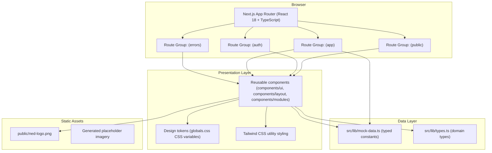
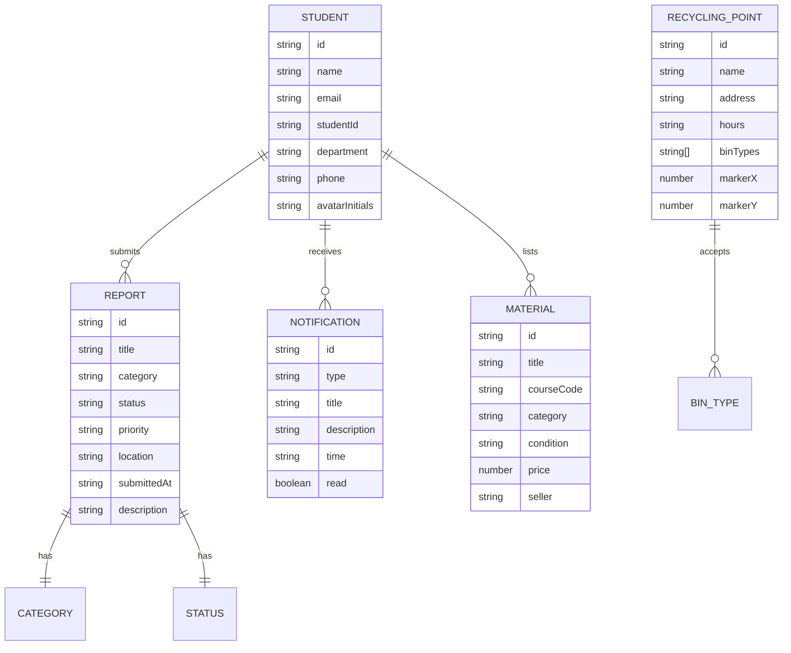

# NED Campus Connect — Technical Architecture Document

## 1. Architecture Design

Frontend-only Next.js application. No backend, no database, no auth provider. All data is local TypeScript mock data; all interactions are client-side state.



## 2. Technology Description

- **Framework**: Next.js 14 (App Router), React 18, TypeScript (strict)
- **Styling**: Tailwind CSS 3 with CSS-variable design tokens in `globals.css`; no component library
- **Icons**: `lucide-react`
- **State**: React `useState` / `useReducer` for local UI interaction; a single `zustand`-free approach is used because no cross-route shared state is required by the UI-only scope
- **Fonts**: Plus Jakarta Sans via `next/font/google` with a system-sans fallback stack
- **Backend**: None
- **Database**: None — mock data only
- **Rationale for Next.js over Vite**: explicitly required by the user brief (App Router, TypeScript, `not-found.tsx`, `error.tsx`)

## 3. Route Definitions

| Route | Purpose |
|-------|---------|
| `/` | Public home page — nav, hero, stats, four feature cards, footer |
| `/signup` | Account creation form + pale-green branding panel |
| `/login` | Login form + pale-green branding panel |
| `/verify-email` | Six-box email verification code entry |
| `/forgot-password` | Request password reset link |
| `/reset-password` | Set a new password |
| `/403` | Access denied error page |
| `/404` | Page not found error page |
| `/500` | Something went wrong error page |
| `/not-found` (App Router `not-found.tsx`) | Catch-all for unknown routes |
| App Router `error.tsx` | Runtime application error boundary UI |
| `/dashboard` | Student dashboard — stats, recent activity, quick actions |
| `/lost-found` | Lost & found item grid with search and category filters |
| `/maintenance` | Complaint form, common issues, my complaints |
| `/study-materials` | Study material listings with search and filters |
| `/recycling` | Recycling locations, map placeholder, waste report form |
| `/my-reports` | Report table with status tabs |
| `/notifications` | Notification feed with read/unread state |
| `/profile` | Profile form, account, notification and privacy settings |
| `/admin` | Admin summary cards, report table, filters, review dialog |

Route groups: `(public)`, `(auth)`, `(app)` (sidebar shell), `(errors)` — each group has its own `layout.tsx` providing the shared chrome.

## 4. API Definitions

None. No network requests are made. All interactive data is local mock data.

## 5. Server Architecture Diagram

Not applicable — no backend.

## 6. Data Model

TypeScript domain types in `src/lib/types.ts`, populated from `src/lib/mock-data.ts`.



### 6.1 Enumerations

- `ReportCategory`: `lost-found | maintenance | study-materials | recycling`
- `ReportStatus`: `pending | in-progress | resolved | rejected`
- `Priority`: `low | medium | high`
- `BinType`: `paper | plastic | metal | glass | organic | e-waste`
- `NotificationType`: `report-update | lost-found | system | material`

## 7. Component Architecture

```
src/
  app/
    (public)/        page.tsx, layout.tsx
    (auth)/          signup/, login/, verify-email/, forgot-password/, reset-password/
    (app)/           layout.tsx (DashboardLayout), dashboard/, lost-found/, maintenance/,
                     study-materials/, recycling/, my-reports/, notifications/, profile/
    (errors)/        403/, 404/, 500/
    error.tsx
    not-found.tsx
    globals.css
    layout.tsx
  components/
    layout/          PublicHeader, Footer, DashboardLayout, DashboardSidebar,
                     DashboardHeader, MobileNavigation, PageHeader, AuthLayout, BrandingPanel
    ui/              Button, Input, Select, Textarea, Checkbox, Switch, FormField, Badge,
                     StatusBadge, Card, StatCard, FeatureCard, SearchBar, FilterChips,
                     EmptyState, SkeletonLoader, ErrorState, ConfirmationDialog, Modal,
                     Alert, Avatar, Progress
    modules/         LostFoundCard, StudyMaterialCard, NotificationItem, ReportTable,
                     ComplaintForm, WasteReportForm, RecyclingMap, CommonIssuesPanel,
                     ProfileForm, AdminReportTable, CodeInput, LoginForm, SignUpForm
  lib/
    types.ts, mock-data.ts, utils.ts (cn helper, formatters)
```

## 8. Design Token Implementation

Design tokens are declared once in `globals.css` as CSS custom properties and mapped into `tailwind.config.ts`, so every component consumes semantic names (`bg-surface`, `text-muted`, `border-line`, `bg-brand-900`) instead of raw hex values.

| Token | Value | Usage |
|-------|-------|-------|
| `--brand-900` | `#00402F` | Sidebar, headings |
| `--brand-700` | `#1F7050` | Primary buttons, links |
| `--brand-600` | `#2E8B62` | Hover, active nav |
| `--brand-100` | `#E0F0E6` | Pale green tiles, chips |
| `--brand-50` | `#F0F7F2` | Auth panel, section tint |
| `--surface` | `#FFFFFF` | Cards, forms |
| `--page` | `#F5F8F6` | App background |
| `--text` | `#0F1F1A` | Body text |
| `--muted` | `#6B7C74` | Helper text |
| `--line` | `#E2E8E4` | Borders |
| `--success` | `#16A34A` | Resolved badge |
| `--warning` | `#F59E0B` | Pending badge |
| `--error` | `#DC2626` | Rejected badge, destructive |
| `--info` | `#0284C7` | Info badge |

## 9. Responsive Strategy

- **≥1024px** — fixed 264px sidebar, sticky 64px header, 4-column feature/stat grids, 3-column item grids.
- **768–1023px** — sidebar collapses to an off-canvas drawer toggled from the header; grids drop to 2 columns; horizontal page padding 24px → 20px.
- **<768px** — single column stacking, drawer navigation with overlay, full-width buttons, filter chips scroll horizontally, tables re-render as stacked card lists.

## 10. Verification Approach

`npm run dev` is started, each route is opened and screenshotted, then compared against the reference collage. `npm run build` and TypeScript checking are run to confirm no broken imports, missing CSS or type errors.

**Documented limitation:** the reference collage image could not be visually inspected in this session (the active model is not multimodal; `Read` on both PNGs returned "Current model cannot read image"). Structure and styling were derived from the written brief plus OCR of the collage captions and palette sampling. Anything not verifiable from the image is documented as an assumption in the final summary rather than claimed as exact.
